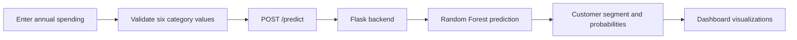

<div align="center">

# Customer Intelligence Dashboard

### Discover purchasing patterns. Understand customer segments. Make smarter decisions.

<p>
  
  
  
  
</p>

<p>
  An interactive customer analytics dashboard that transforms annual spending data into clear, visual purchasing profiles using machine learning.
</p>

</div>

---

## Overview

**Customer Intelligence Dashboard** is a modern web interface for analyzing customer purchasing behavior across six product categories:

- Fresh products
- Milk
- Grocery
- Frozen products
- Detergents & Paper
- Delicassen

Enter a customer's annual spending values and receive an easy-to-understand purchasing profile, confidence score, spending-shape visualization, probability breakdown, and an explanation of why the profile was selected.

The frontend is designed to work with a Flask backend that exposes a `/predict` endpoint. The backend uses **DBSCAN** to create customer segments and a **Random Forest** classifier to predict the most likely segment for new customers.

## Preview

> Add a screenshot or screen recording of the dashboard here.
>
> ```md
> 
> ```

## Features

### Interactive spending analysis

- Enter annual spending for all six categories.
- See total spending update in real time.
- View a proportional spending-mix bar as values change.
- Identify the customer's dominant spending category.

### Machine-learning profile prediction

- Classifies customers into descriptive purchasing profiles.
- Displays model confidence with an animated circular gauge.
- Shows prediction probabilities for each available segment.
- Provides a backend-generated explanation for the predicted profile.

### Visual customer insights

- Responsive radar chart for the customer's spending shape.
- Animated result cards and probability bars.
- Clear visual hierarchy for fast interpretation.
- Accessible status messages and reduced-motion support.

### Modern responsive interface

- Clean purple gradient visual system.
- Glassmorphism-inspired navigation and result panels.
- Responsive layouts for desktop, tablet, and mobile screens.
- No frontend framework required—the interface is built with semantic HTML, CSS, and vanilla JavaScript.

## How It Works



1. The user enters non-negative annual spending values.
2. The frontend calculates total spending and the dominant category.
3. The values are sent as JSON to the Flask `/predict` endpoint.
4. The backend predicts a customer segment.
5. The dashboard renders the profile name, confidence, radar chart, explanation, and probabilities.

## Tech Stack

| Layer | Technology |
| --- | --- |
| Frontend | HTML5, CSS3, Vanilla JavaScript |
| Typography | Plus Jakarta Sans |
| Visualization | Inline SVG, CSS animations |
| Backend | Flask / Python |
| Classification | Random Forest |
| Segmentation | DBSCAN |
| Data format | JSON over HTTP |

## Project Structure

```text
customer-intelligence/
├── index.html          # Interactive customer analysis dashboard
├── app.py              # Flask backend and prediction endpoint
├── model/              # Saved model and preprocessing artifacts
├── data/               # Training data or dataset files
├── assets/             # Screenshots, logos, and static assets
├── requirements.txt    # Python dependencies
└── README.md           # Project documentation
```

## Getting Started

### Prerequisites

- Python 3.9+
- pip
- A trained Random Forest model and any required preprocessing artifacts

### 1. Clone the repository

```bash
git clone https://github.com/your-username/customer-intelligence.git
cd customer-intelligence
```

### 2. Create a virtual environment

```bash
python -m venv .venv
```

Activate it on macOS/Linux:

```bash
source .venv/bin/activate
```

Activate it on Windows:

```powershell
.venv\Scripts\activate
```

### 3. Install dependencies

```bash
pip install -r requirements.txt
```

### 4. Start the Flask backend

```bash
python app.py
```

The application should be available at:

```text
http://127.0.0.1:5000/
```

> Open the dashboard through the Flask server rather than opening `index.html` directly. The frontend sends requests to the relative `/predict` route.

## Prediction API

The frontend sends a `POST` request to `/predict` with this payload:

```json
{
  "fresh": 12000,
  "milk": 9000,
  "grocery": 7500,
  "frozen": 500,
  "detergents_paper": 2500,
  "delicassen": 1500
}
```

A successful response should follow this structure:

```json
{
  "success": true,
  "prediction": {
    "cluster": 0,
    "segment_name": "Moderate Spending",
    "confidence": 87,
    "why": "The customer shows a balanced purchasing pattern with moderate annual spending.",
    "probabilities": {
      "cluster_0": 87,
      "cluster_1": 13
    }
  }
}
```

### Response fields

| Field | Description |
| --- | --- |
| `cluster` | Numeric identifier for the predicted segment |
| `segment_name` | Human-readable customer profile name |
| `confidence` | Overall prediction confidence as a percentage |
| `why` | Explanation generated by the backend |
| `probabilities` | Confidence distribution across available segments |

## Example Backend Contract

A minimal Flask route can follow this pattern:

```python
from flask import Flask, jsonify, request

app = Flask(__name__)

@app.post("/predict")
def predict():
    data = request.get_json()

    # Validate, transform, and pass the six features to your model here.
    # prediction = model.predict(...)
    # probabilities = model.predict_proba(...)

    return jsonify({
        "success": True,
        "prediction": {
            "cluster": 0,
            "segment_name": "Moderate Spending",
            "confidence": 87,
            "why": "Profile generated from spending across all six categories.",
            "probabilities": {
                "cluster_0": 87,
                "cluster_1": 13
            }
        }
    })

if __name__ == "__main__":
    app.run(debug=True)
```

Replace the example response with the output from your trained model and preprocessing pipeline.

## Design Highlights

The interface uses a focused visual language to make analytical output easier to scan:

- **Deep purple gradients** communicate intelligence and depth.
- **Soft lavender surfaces** keep data entry approachable.
- **Large numerical typography** gives important metrics priority.
- **Radar visualization** makes category imbalance immediately visible.
- **Confidence indicators** help users understand prediction strength.
- **Responsive cards** keep the experience usable on smaller screens.

## Validation and Error Handling

The dashboard prevents invalid submissions by checking that every field contains a finite, non-negative number. If the backend is unavailable or returns an invalid response, the interface displays a clear error state and suggests checking that the Flask server is running.

## Future Improvements

- Add customer history and trend analysis.
- Support CSV upload for batch predictions.
- Add model performance metrics such as precision, recall, and F1 score.
- Include feature importance explanations from the Random Forest model.
- Store prediction history in a database.
- Add authentication and role-based analytics views.
- Deploy the frontend and Flask API with Docker.

## Contributing

Contributions are welcome. To contribute:

1. Fork the repository.
2. Create a feature branch:

   ```bash
   git checkout -b feature/your-feature
   ```

3. Commit your changes:

   ```bash
   git commit -m "Add your feature"
   ```

4. Push the branch and open a pull request.

Please keep contributions focused, documented, and consistent with the existing UI and API contract.

## License

This project is available under the MIT License. Add a `LICENSE` file to the repository before publishing if you intend to use this license.

---

<div align="center">

Built for clearer customer insight through thoughtful design and machine learning.

</div>
